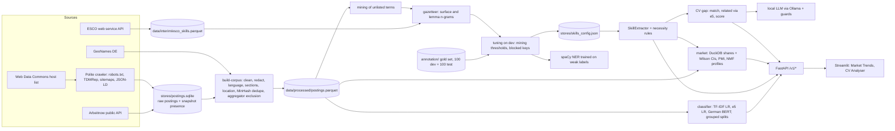

# Architecture

## Components (as implemented)

| module | responsibility |
|---|---|
| `harvest/client.py` | polite HTTP client: per-host spacing, backoff on 429 and 5xx, SQLite response cache |
| `harvest/arbeitnow.py` | snapshot of the Arbeitnow API (all pages, cached per snapshot date) |
| `harvest/crawl.py`, `policy.py`, `jsonld.py` | career-site crawler: robots.txt, TDMRep, job-board exclusion, sitemap discovery, JSON-LD JobPosting extraction, 16 hosts in parallel |
| `harvest/store.py` | raw posting store with first/last seen and per-snapshot presence |
| `text/` | HTML cleaning, redaction, language detection (lingua), section splitting, GeoNames location matching, MinHash deduplication, corpus build |
| `skills/` | ESCO fetch, gazetteer, mining, necessity rules, weak-label NER, gold evaluation, tuned runtime extractor |
| `classify/` | label table and grouped splits, baselines, BERT fine-tuning, metrics with bootstrap intervals |
| `market/` | DuckDB aggregates with Wilson intervals and suppression, co-occurrence PMI, NMF role profiles |
| `gap/` | CV parsing, gap matching, score, e5 embeddings, LLM with structured output, guards, evaluation |
| `manifest.py`, `colab.py`, `report.py` | reproducibility manifests, Colab packaging and import, result rendering |
| `api/`, `app/` | FastAPI service and Streamlit UI (HTTP client only) |

Storage: SQLite for the raw store and HTTP cache, Parquet for the corpus and ESCO table, DuckDB for aggregate queries. Nothing in `data/`, `stores/`, `models/`, `annotation/` (except the guidelines in `docs/`) or `logs/` is committed.
